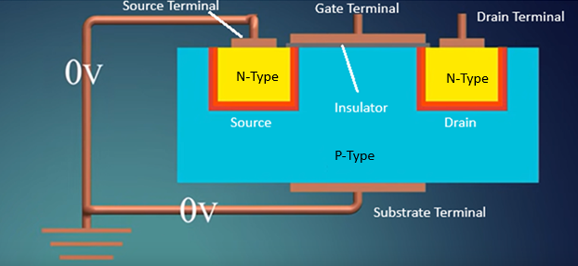
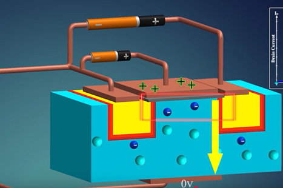
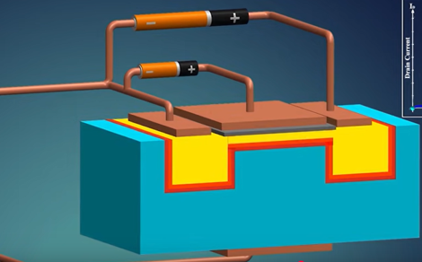
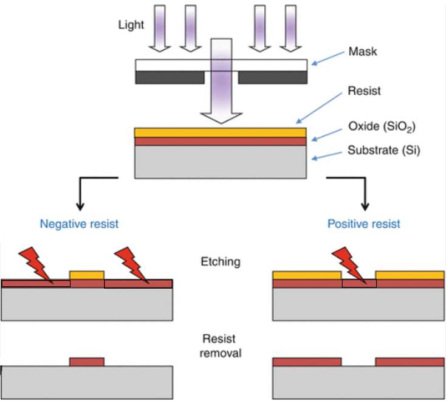
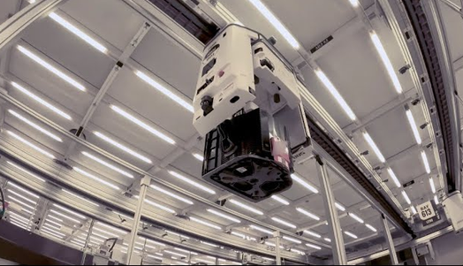

# Semiconductor Manufacturing — Technical Guide

## Introduction

A **semiconductor** is a material whose electrical conductivity can be controlled. Its conductivity depends on factors such as composition, temperature, applied electric fields, and exposure to light. Silicon is the principal semiconductor material discussed in this guide.

This guide presents the material, device structures, manufacturing processes, equipment, and supporting industrial components involved in producing semiconductor components. It uses engineering terminology while keeping device physics and process details at an overview level.

A **substrate** is the base material in and on which electronic devices and their interconnections are built.

**Silicon wafer manufacturing** produces this substrate in the form of a **wafer—a thin disc of silicon** that is finished, polished, cleaned, and inspected.

**Semiconductor device manufacturing** produces integrated circuits, such as processors, memory chips, and controllers. It starts with a silicon wafer, forms electronic devices within the silicon substrate and at its surface, then builds insulating layers and metal wiring above them to connect the devices into circuits. The circuits are tested, separated into individual dies, assembled into packages, and tested as finished components.

Part I explains production of the wafer. Part II describes the physical structures and finished component that must be built. Part III explains how they are manufactured and tested. Part IV covers the manufacturing environment and industrial components that support the equipment.

## Table of Contents

### Part I — Silicon Wafer Manufacturing

1. **Silicon Wafer Manufacturing**
   - 1.1 Silicon Purification
   - 1.2 Crystal Growth and Substrate Doping
   - 1.3 Wafer Slicing
   - 1.4 Finishing, Polishing, and Cleaning
   - 1.5 Inspection and the Prepared Wafer
   - 1.6 Other Semiconductor Wafer Materials

### Part II — Semiconductor Devices and Integrated Circuits

2. **Semiconductor Devices and Integrated Circuit Structure**
   - 2.1 Electronic Devices
   - 2.2 The Silicon MOS Transistor
   - 2.3 Many Devices on One Wafer
   - 2.4 Insulating Regions and Layers
   - 2.5 The Die — A Complete Integrated Circuit
   - 2.6 Contacts and Metal Wiring
   - 2.7 Multiple Wiring Levels and Vias
   - 2.8 The Package

### Part III — Semiconductor Device Manufacturing

3. **Silicon Wafers as the Substrate**
   - 3.1 The Prepared Wafer as the Manufacturing Input
   - 3.2 Surface Condition and Preparation
4. **Semiconductor Device Manufacturing Overview**
   - 4.1 Overall Manufacturing Sequence
   - 4.2 Circuit Design and Process Specifications
   - 4.3 FEOL, MOL, and BEOL
   - 4.4 Front-End and Back-End Manufacturing
5. **Circuit Fabrication**
   - 5.1 Circuit Fabrication Sequence
   - 5.2 Oxidation and Deposition
   - 5.3 Photolithography
   - 5.4 Etching
   - 5.5 Doping
   - 5.6 Annealing
   - 5.7 Chemical Mechanical Planarization
   - 5.8 Cleaning
   - 5.9 Inspection and Metrology
   - 5.10 Device Formation
   - 5.11 Contacts and Metal Interconnections
   - 5.12 Protective Layers and Connection Pads
   - 5.13 Repeated Processing Across the Wafer
6. **Material Handling Through the Fab**
   - 6.1 Wafer Carriers
   - 6.2 Equipment Loading and Unloading
   - 6.3 Transport Between Tools
   - 6.4 Wafer Tracking and Processing History
7. **From Fabricated Wafer to Finished Product**
   - 7.1 Wafer Testing
   - 7.2 Dicing
   - 7.3 Assembly and Packaging
   - 7.4 Final Testing
   - 7.5 The Finished Output

### Part IV — Manufacturing Environment and Industrial Components

8. **The Fab Environment and Supporting Systems**
   - 8.1 Cleanrooms
   - 8.2 Temperature, Humidity, and Vibration Control
   - 8.3 Controlled Lighting
   - 8.4 Ultrapure Water
   - 8.5 Chemical and Gas Delivery
   - 8.6 Vacuum, Exhaust, and Waste Treatment
   - 8.7 Power and Cooling
9. **General Industrial Components Used in Semiconductor Equipment**
   - 9.1 Pneumatic Components
   - 9.2 Motion and Mechanical Components
   - 9.3 Clamping, Locating, and Gripping Components
   - 9.4 Fluid-Control Components
   - 9.5 Vacuum Components
   - 9.6 Sensors and Instrumentation
   - 9.7 Electrical Power and Automation Components
   - 9.8 Heating and Cooling Components

---

# Part I — Silicon Wafer Manufacturing

## 1. Silicon Wafer Manufacturing

A **substrate** is the base material in and on which electronic devices and their interconnections are built.

Silicon wafer manufacturing produces this substrate in the form of a **wafer—a thin disc of silicon**.

**Silicon Wafer Manufacturing Process**

Silicon purification → Crystal growth → Slicing → Finishing → Prepared wafer

The **prepared wafer is the output of silicon wafer manufacturing and the input to semiconductor device manufacturing**.

### 1.1 Silicon Purification

Silicon occurs naturally in compounds such as **silica**, or silicon dioxide (SiO₂). Producing semiconductor-grade silicon requires extracting silicon and removing impurities to extremely low concentrations.

An initial reduction process produces metallurgical-grade silicon. Further purification commonly involves converting the silicon into chemical compounds that can be purified, then depositing high-purity **polycrystalline silicon**, often called **polysilicon**.

Polysilicon contains many crystalline grains. It provides the feedstock for growing the single-crystal silicon used in most silicon wafers.

Unwanted impurities can alter electrical behavior, introduce defects, or impair device performance. A **dopant**, in contrast, is an element deliberately introduced in controlled quantities to modify semiconductor electrical properties.

**Equipment used:** reduction furnaces, chemical purification and distillation systems, and polysilicon deposition reactors.

### 1.2 Crystal Growth and Substrate Doping

Purified silicon is grown into a **single crystal**, with a continuous crystal lattice rather than many differently oriented grains.

A widely used method is the **Czochralski process**:

1. High-purity polysilicon is melted in a **crucible—a heat-resistant vessel that holds the molten silicon**.
2. A small seed crystal contacts the molten silicon.
3. The seed is slowly withdrawn while the crystal and crucible rotate under controlled conditions.
4. Silicon solidifies onto the seed, forming a cylindrical single-crystal **ingot**.

**Crystal orientation** describes the alignment of the silicon crystal lattice. It influences electrical behavior and how the silicon responds to manufacturing processes. The seed establishes this orientation. Temperature, pulling speed, and rotation influence growth and ingot dimensions.

Controlled quantities of dopants may be added to establish the silicon's conductivity type and **resistivity**. Resistivity describes a material's opposition to electrical conduction; it is the reciprocal of conductivity.

Boron commonly produces **p-type silicon**, while phosphorus or arsenic can produce **n-type silicon**. These are doping classifications that describe different electrical properties.

This doping establishes the starting substrate's electrical properties. Device fabrication later modifies selected regions to form the required devices.

Another method, **float-zone growth**, moves a molten zone along a silicon rod. It is used for applications requiring particular purity and electrical characteristics.

**Equipment used:** crystal pullers, float-zone systems, heating systems, atmosphere controls, and crystal-growth monitoring instruments.

### 1.3 Wafer Slicing

The ingot is shaped to the required diameter and prepared for slicing. An orientation feature, such as a notch, identifies crystallographic orientation and supports subsequent alignment and handling.

Precision slicing separates the ingot into thin wafers. Cutting introduces surface damage and geometric variations, so further processing establishes the required thickness, flatness, and surface condition.

**Equipment used:** ingot grinding systems, orientation measurement tools, and precision wire saws.

### 1.4 Finishing, Polishing, and Cleaning

Depending on the wafer specification, finishing includes:

- **Edge shaping:** rounds and finishes the edge to reduce damage during handling.
- **Lapping or grinding:** adjusts thickness and geometry.
- **Chemical etching:** removes material damaged by mechanical processing.
- **Polishing:** produces the required smoothness and flatness.
- **Cleaning:** removes particles, residues, and contaminants.

Single-side or double-side polishing is selected according to the wafer specifications.

Some products receive additional preparation. **Epitaxial growth** adds crystalline semiconductor material that follows the orientation of the underlying crystal. It can establish a surface layer with electrical properties different from those of the bulk wafer. Epitaxy is also used during device fabrication where required.

For example, a silicon wafer can receive an epitaxial silicon layer with a different dopant concentration and therefore a different electrical resistivity. The added layer follows the underlying crystal orientation while providing surface properties selected for the devices to be manufactured. This allows the bulk wafer and the surface layer to have different electrical properties.

**Equipment used:** edge grinders, lapping and grinding machines, wet etching systems, polishing machines, wafer cleaning systems, and epitaxial reactors where required.

### 1.5 Inspection and the Prepared Wafer

Inspection and measurement determine whether the wafer meets specifications for diameter, thickness, flatness, surface roughness, contamination, defects, resistivity, and conductivity type. **Bow and warp** describe deviations of the wafer's shape from an ideal plane.

Qualified wafers are packaged for protected transport. The output is a **prepared silicon wafer** with specified material, electrical, geometric, and surface characteristics.

**Equipment used:** dimensional and surface metrology systems, defect inspection tools, electrical measurement instruments, and clean packaging systems.

### 1.6 Other Semiconductor Wafer Materials

Silicon is the main material covered in this chapter, but other semiconductor materials are used or developed for demanding applications. Material selection can address high operating temperatures, high voltages, and heat removal, as well as other electrical requirements.

**Silicon carbide (SiC)** is an established wafer material for power semiconductor devices. Its material properties support high-voltage and high-temperature applications, including power conversion in automotive and industrial equipment.

**Diamond** is being developed as a semiconductor wafer material for demanding power applications. Its high thermal conductivity helps carry heat away, while its ability to withstand strong electric fields offers potential for high-voltage devices. Diamond-based semiconductor devices and wafer manufacturing remain areas of research and development; they are less mature than silicon and silicon carbide technologies.

Using diamond as the semiconductor material is different from using it as a heat spreader beneath a device made from another semiconductor. A **heat spreader** transfers heat away from the device without necessarily forming part of its active electronic structure.

Different wafer materials require their own crystal-growth, finishing, and device-processing methods. The silicon manufacturing sequence described above should not be assumed to apply unchanged to them.

**Wafer manufacturing video:** [Watch on YouTube](https://www.youtube.com/watch?v=jnnXZa_hWq4).

---

# Part II — Semiconductor Devices and Integrated Circuits

## 2. Semiconductor Devices and Integrated Circuit Structure

This chapter explains **what must be built within the silicon substrate and on its surface to form an integrated circuit**: electronic devices, insulating structures, contacts, metal wiring, and vias. It also introduces the package that supports and connects the die as a finished semiconductor component.

An **integrated circuit (IC)** combines electronic devices and their electrical interconnections in a manufactured semiconductor structure. Part III explains how these structures are manufactured, connected, assembled, and tested.

### 2.1 Electronic Devices

Electronic devices perform functions such as switching, amplification, rectification, resistance, capacitance, and sensing.

**Transistors** control current and are fundamental to switching, amplification, and signal processing. Diodes, resistors, and capacitors provide other circuit functions.

In digital circuits, arrangements of transistors implement logic gates and memory cells. Larger combinations form functional blocks that work together in processors, memories, controllers, and other integrated systems.

### 2.2 The Silicon MOS Transistor

A **MOSFET** is a **metal–oxide–semiconductor field-effect transistor**. It uses the gate's electric field to control conduction between semiconductor regions called the **source** and **drain**.

A simplified planar silicon MOS transistor provides a useful example of the structures manufacturing must create.

- **Body (B)**: Semiconductor region in which the transistor is formed. It may be the silicon substrate or a well—a region within it whose doping type and concentration have been modified.
- **Source (S) and drain (D)**: Doped semiconductor regions at the ends of the controlled conducting path.
- **Gate insulator**: Thin dielectric—an electrically insulating material—separating the gate from the semiconductor.
- **Gate (G)**: Conductive electrode that controls the channel through an electric field.
- **Channel**: Region between source and drain whose conductivity is controlled by the gate.

#### The Transistor as an Electronic Switch

Applying a voltage to the gate creates an **electric field through the gate insulator** that controls conduction between source and drain. The transistor can therefore act as an **electronic switch**.

In the simplified planar structure, the conducting channel occupies a very thin region near the silicon surface beneath the gate. The insulator electrically separates the gate from the semiconductor, while the electric field controls the conducting path.

#### NMOS and PMOS

A **hole** is an unoccupied electron state in the semiconductor that behaves as a positive charge carrier.

Two complementary MOS transistor types are widely used:

- **NMOS**: n-type source and drain in a p-type body region. Principal channel carriers: Electrons.
- **PMOS**: p-type source and drain in an n-type body region. Principal channel carriers: Holes.

**CMOS**, or **complementary MOS**, uses NMOS and PMOS transistors together. Appropriately doped wells allow both types to be formed on the same wafer.

### 2.3 Many Devices on One Wafer

Manufacturing forms large numbers of MOS transistors and other electronic devices in and on the wafer. Their positions and dimensions follow the circuit design.

The devices are arranged into groups that will perform the intended circuit functions. They must be electrically isolated where separation is required and connected where the design requires a conducting path.

### 2.4 Insulating Regions and Layers

**Insulating regions** separate neighboring devices. **Insulating layers** separate conductive structures and successive wiring levels. The gate insulator performs its specific role within the transistor.

These dielectrics have defined compositions, dimensions, and locations. Their properties affect electrical isolation, capacitance, and reliability.

Insulation therefore forms part of the functional structure, alongside semiconductor regions and conductors.

### 2.5 The Die — A Complete Integrated Circuit

A **die** is an individual semiconductor chip. Before dicing, it occupies a defined area of the wafer; after dicing, it is the separated piece containing the fabricated devices and their interconnections. **Dicing** separates the wafer into individual dies.

A wafer normally contains a repeating pattern of die areas, each containing a copy of the same integrated circuit design. Each area contains a complete integrated circuit—for example, a processor, memory chip, or controller—made up of interconnected electronic devices organized into smaller circuits and functional blocks. Depending on its design, the integrated circuit can contain millions or billions of transistors connected to form those circuits and functional blocks.

The wafer allows many dies to undergo manufacturing operations together. Each die contains the devices and interconnections required for its intended function.

The complexity of a die comes from the number and arrangement of devices, the connections between them, and the physical requirements for manufacturing that arrangement.

- **Wafer**: Semiconductor disc used as the substrate for manufacturing devices and circuits
- **Die**: Individual circuit area on the wafer, or the chip separated from it

**Video:** [How do Transistors Build into a CPU? 🖥️🤔 How do Transistors Work?](https://www.youtube.com/watch?v=_Pqfjer8-O4).

### 2.6 Contacts and Metal Wiring

Devices must connect to other circuit elements. For a MOS transistor, this includes its source, drain, and gate; the body also has an appropriate electrical connection in the conventional planar example.

**Contacts** establish electrical connections to device regions and electrodes. **Metal lines** connect selected points, carrying signals and distributing power.

The arrangement of these connections turns the devices into working circuits. Insulation separates neighboring conductive paths except where the design requires them to join.

### 2.7 Multiple Wiring Levels and Vias

Complex integrated circuits can contain millions or billions of MOS transistors that must be connected according to the circuit design. Routing these connections within the limited area of a die requires multiple metal wiring levels. Insulating layers separate the levels, allowing conductive paths to cross above or below one another without unintended electrical contact.

Insulating material separates the levels. **Vias** provide vertical electrical connections between selected conductors on different levels. Together, metal lines and vias form a three-dimensional interconnection network.

For example, Intel’s 22 nm, 15-core “Ivytown” Xeon processor contained approximately **4.31 billion transistors and nine metal wiring levels within a single die**.

The network reaches **connection pads**: conductive areas that provide suitable interfaces for external connections. Protective layers cover the completed circuit, with selected openings providing access to these pads.

### 2.8 The Package

A **package** supports and protects one or more dies, provides electrical connections to other electronics, and helps manage heat.

Connections between the die and package may use fine wires or conductive bumps. External terminals then connect the packaged component to the surrounding electronic system.

The finished component therefore includes both the fabricated die and the assembly that makes it usable in a system.

---

# Part III — Semiconductor Device Manufacturing

## 3. Silicon Wafers as the Substrate

### 3.1 The Prepared Wafer as the Manufacturing Input

Device fabrication begins with the prepared wafer produced in Part I. Its material, crystal orientation, conductivity type, resistivity, dimensions, and surface condition must suit the intended manufacturing technology.

The wafer provides both the semiconductor material in which selected device regions are formed and the surface on which additional structures are built. Some products use an epitaxial layer as the starting device region.

### 3.2 Surface Condition and Preparation

Processing requires surfaces with suitable cleanliness and condition. Particles, residues, and unwanted surface films can interfere with later operations.

Cleaning and any required surface treatment prepare the wafer for the next operation. Similar preparation recurs throughout fabrication as new surfaces and materials are exposed.

**Ultrapure water (UPW)** is used extensively for wafer cleaning and rinsing. It is purified to remove particles and dissolved contaminants that could affect the wafer surface.

**Equipment used:** wafer cleaning and surface-treatment tools, handling systems, and inspection and metrology tools.

## 4. Semiconductor Device Manufacturing Overview

Chapter 2 describes what must be built. This chapter explains how manufacturing is organized to produce it.

### 4.1 Overall Manufacturing Sequence

**Semiconductor Device Manufacturing Process**

Prepared wafer → Circuit fabrication → Wafer testing → Dicing → Assembly and packaging → Final testing

- **Circuit fabrication**: Construct the devices and interconnections described in Chapter 2
- **Wafer testing**: Evaluate circuits before separation
- **Dicing**: Separate individual dies
- **Assembly and packaging**: Assemble selected dies into components with external connections
- **Final testing**: Evaluate finished components against specifications

This is the typical sequence. Some packaging technologies perform operations before dicing or combine stages differently.

### 4.2 Circuit Design and Process Specifications

The **circuit design** defines the electronic function, required devices, and electrical connections. The **physical layout** translates the design into shapes and positions of device regions, contacts, and wiring. Layout information is used to produce fabrication masks.

The layout must comply with **design rules**: manufacturing constraints such as minimum feature dimensions, spacing, and alignment requirements.

**Process specifications** define required materials, dimensions, electrical properties, and acceptable variations. A **process recipe** specifies equipment settings for an operation, such as temperature, pressure, gas flow, time, and power.

Manufacturing follows a coordinated route through processing and measurement equipment. Each operation forms, modifies, or checks part of the structure.

### 4.3 FEOL, MOL, and BEOL

- **FEOL — Front End of Line**: Device formation — Form electronic devices and their isolation
- **MOL — Middle of Line**: Device-to-wiring connections — Form contacts and local interconnections
- **BEOL — Back End of Line**: Wiring construction — Form metal wiring levels and vias

The precise boundaries vary with the technology. Processing operations recur within these stages as needed.

### 4.4 Front-End and Back-End Manufacturing

- **Front-end manufacturing** refers to wafer fabrication: creating devices and their interconnections in and on the prepared wafer. It includes FEOL, MOL, and **BEOL**—the metal wiring formed during wafer fabrication.
- **Back-end manufacturing** refers to the subsequent preparation of dies as finished components, generally including assembly, packaging, and testing. Dicing prepares individual dies for assembly.

Wafer testing takes place between fabrication and die assembly; its organizational classification can vary. Silicon wafer manufacturing is the preceding process that supplies the prepared substrate.

## 5. Circuit Fabrication

Circuit fabrication is carried out in **semiconductor fabrication plants, commonly called fabs**. It translates the design into physical structures through operations that **add material, define patterns, remove material, modify electrical properties, and prepare surfaces for further work**.

For example, fabs in the Phoenix metropolitan area include **TSMC’s Fab 21 in north Phoenix, Intel’s Ocotillo campus in Chandler, and NXP’s Chandler Fab**. These facilities fabricate semiconductor devices and circuits on wafers.

**Fab video:** [Intel Arizona factory tour](https://www.youtube.com/watch?v=IUIh0fOUcrQ).

**Fab video:** [TSMC Fab Tour](https://www.youtube.com/watch?v=divOKxuYklM).

### 5.1 Circuit Fabrication Sequence

**Circuit Fabrication Process — Front-End Manufacturing**

Prepared wafer → Device formation → Contacts → Metal interconnections → Protective layers and connection pads → Fabricated wafer

Within these stages, the operations below are repeated according to the structure being built. This sequence describes the major construction stages; individual process routes vary with the technology.

### 5.2 Oxidation and Deposition — Add Material

**Oxidation** forms an oxide by reacting a material with oxygen. Thermal oxidation grows silicon dioxide by exposing silicon to oxygen or water vapor at controlled temperatures. Some silicon is consumed as the oxide grows.

**Deposition** adds material to an existing surface as a thin layer, or **film**. Films may be semiconductors, insulators, conductors, or temporary processing materials.

- **Chemical vapor deposition (CVD):** gases react or decompose to form a solid film.
- **Physical vapor deposition (PVD):** material transfers from a source to the wafer, commonly by sputtering.
- **Atomic layer deposition (ALD):** successive surface reactions build a film with precise thickness control.
- **Electroplating:** electrical current deposits metal from a liquid solution.

Epitaxy grows crystalline semiconductor material following the underlying crystal orientation. It can be used in wafer preparation or device fabrication.

Many films are deposited across the surface and patterned afterward using photolithography and etching.

**Equipment used:** oxidation furnaces, CVD reactors, PVD systems, ALD systems, epitaxial reactors, and electroplating tools.

Reference: [Lam Research — Deposition Essentials](https://newsroom.lamresearch.com/Deposition-Essentials-Semi-101).

### 5.3 Photolithography — Define Patterns

**Photolithography** uses light to define where later processing will occur. **Photoresist** is a light-sensitive material whose response to a chemical **developer** changes after exposure. The developer selectively removes resist to reveal a pattern. A **mask**, or **reticle**, carries pattern information for the exposure system.

A typical sequence is:

1. **Coat:** dispense liquid photoresist onto the wafer and spin it to spread a thin, uniform coating.
2. **Bake:** heat the coating, commonly on a hot plate, to remove much of the solvent and stabilize it for exposure.
3. **Align and expose:** align the new pattern with existing features and expose selected resist areas to light.
4. **Bake after exposure, when required:** apply controlled heating to support the resist's chemical reactions.
5. **Develop:** remove selected resist portions, leaving a patterned mask.
6. **Check:** inspect or measure the pattern before further processing.

With **positive resist**, exposed areas are removed during development. With **negative resist**, exposed areas remain.

The patterned resist guides operations such as etching and selective ion implantation. Some methods also use it for selective plating or other processing. Exposure changes resist chemistry; development creates the openings; subsequent processing acts through those openings.

**Overlay** describes alignment between successive patterns. Exposure systems may use **deep ultraviolet (DUV)** or **extreme ultraviolet (EUV)** light; not every chip or layer requires EUV.

**Equipment used:** resist coating and developing tracks, bake hot plates, mask aligners, steppers, and scanners.

Reference: [ASML — Six Crucial Steps in Semiconductor Manufacturing](https://www.asml.com/en/company/stories/2021/semiconductor-manufacturing-process-steps).

**Video:** [Photolithography — Duke University — SMIF](https://www.youtube.com/watch?v=udXHWVejDj0).

**Video:** [How are Billions of Nanoscopic Transistors Made into a Microchip? — EUV Photolithography — ASML](https://www.youtube.com/watch?v=B2482h_TNwg).

### 5.4 Etching — Remove Material

**Etching** removes material from selected areas. It can remove semiconductors, insulators, and conductors, forming device features or openings for contacts and vias.

Photolithography defines a patterned mask that protects material that should remain and exposes material to be removed. The mask may be resist or a more durable **hard mask** into which the resist pattern has been transferred.

**Wet etching** uses liquid chemicals. **Dry etching** uses gases, often activated by plasma—an energized gas containing free electrons, ions, and other reactive species.

Control includes depth, feature shape, and **selectivity**, the relative removal rates of different materials. After pattern transfer, resist is stripped and residues are cleaned away. Development, etching, and stripping are separate operations.

**Equipment used:** wet processing benches, single-wafer wet etchers, plasma etchers, and resist-stripping systems.

Reference: [Lam Research — Etch Essentials](https://newsroom.lamresearch.com/etch-essentials-semiconductor-manufacturing).

### 5.5 Doping — Modify Electrical Properties

**Doping** introduces selected elements to change semiconductor electrical properties. **Ion implantation is a method of doping**: it accelerates dopant ions into the semiconductor rather than forming a coating on its surface.

For selective implantation, a mask defined by photolithography exposes regions to receive dopants and protects other regions. Implant dose and energy help control the amount and depth of implanted ions.

Dopants can also be introduced by diffusion or during crystal and epitaxial growth.

**Equipment used:** ion implanters, diffusion furnaces, and growth reactors capable of introducing dopants.

Reference: [Applied Materials — Modify](https://www.appliedmaterials.com/us/en/semiconductor/products/modify.html).

### 5.6 Annealing — Apply Controlled Heat

**Annealing** is a controlled heat treatment. After implantation, it can repair crystal damage and activate dopants so they contribute to the intended electrical behavior. Thermal treatments also improve film properties or support electrical-contact formation.

Temperature and time must be controlled because heat can move dopants or alter existing structures.

**Equipment used:** furnaces, rapid thermal processing systems, and laser annealing systems.

### 5.7 Chemical Mechanical Planarization — Flatten Surfaces and Remove Excess Material

**Chemical mechanical planarization (CMP)** combines chemical action and mechanical polishing. The wafer contacts a polishing pad while a **slurry**, a liquid containing chemicals and often abrasive particles, assists removal.

CMP flattens layers or removes excess metal after openings are filled. Metal remains in the intended openings while excess material above the surface is removed. Cleaning follows to remove slurry and residues.

**Equipment used:** CMP polishing systems, slurry delivery systems, and post-CMP cleaning tools.

### 5.8 Cleaning — Remove Particles, Residues, and Contaminants

Cleaning prepares surfaces before operations such as deposition and resist coating and removes residues after processing. Methods are selected according to the materials present and what must be removed.

Cleaning materials include ultrapure water, selected acids, bases, oxidizing solutions, solvents, and reactive gases or plasma. Ultrapure water is highly purified to avoid introducing contamination during cleaning and rinsing.

Cleaning and rinsing recur throughout manufacturing and account for substantial water use.

**Equipment used:** wet cleaning benches, single-wafer cleaning systems, spray tools, megasonic cleaning systems, plasma cleaning tools, and wafer dryers.

### 5.9 Inspection and Metrology — Check the Results

**Inspection** searches for defects, such as particles or incomplete patterns. **Metrology** measures properties such as film thickness, dimensions, surface shape, and overlay.

These checks evaluate physical structures. Electrical testing, discussed in Chapter 7, evaluates circuit behavior.

**Equipment used:** optical and electron-beam inspection systems, measurement microscopes, film-thickness tools, surface-measurement tools, and overlay measurement systems.

### 5.10 Device Formation

The fabrication operations establish the structures described in Chapter 2. In a simplified MOS example, neighboring devices require isolation, semiconductor regions require specified doping, and the gate insulator and gate structure must be formed.

These tasks use multiple operations. A transistor is not deposited as one complete layer. Their order depends on the device technology.

For one patterned etch operation, an illustrative sequence is:

Prepare and clean → Deposit the film → Coat and bake resist → Align and expose → Develop → Etch → Strip and clean → Inspect or measure

For a masked implantation operation, implantation acts through the patterned openings instead of etching. Appropriate resist removal, cleaning, and annealing follow. Other operations are included where needed.

**Equipment used:** deposition and oxidation tools, lithography systems, etchers, implanters, annealing systems, cleaning tools, and inspection and metrology tools.

### 5.11 Contacts and Metal Interconnections

After device formation, insulating material covers and separates structures. Photolithography defines openings, etching exposes selected device regions, and conductive material establishes contacts to the wiring network.

One wiring method forms openings in insulation and fills them with metal. This is **damascene processing**:

1. Deposit insulation over existing structures.
2. Use photolithography to define conductive paths and vertical connections.
3. Etch trenches for horizontal metal lines and holes for vias, using the required patterning sequence.
4. Add required supporting films and fill the openings with metal.
5. Use CMP to remove excess material above the surface.
6. Clean and check the result.

A **liner** is a thin coating inside an opening that supports the selected integration method. A **diffusion barrier** limits metal migration into surrounding materials. A **seed layer** provides a conductive starting surface for electroplating where that method is used.

Other methods deposit metal first and pattern it by lithography and etching. The process depends on the material and technology.

Additional insulation, lines, and vias build successive wiring levels. Each via must reach the intended conductor and remain isolated from neighboring paths.

**Equipment used:** dielectric and metal deposition systems, lithography systems, etchers, electroplating tools where applicable, CMP systems, and cleaning and metrology tools.

### 5.12 Protective Layers and Connection Pads

Protective insulating layers, commonly called **passivation layers**, cover the completed circuit. Selected openings provide access to connection pads.

Pad arrangements suit the connection method. Wire-bond pads are commonly near die edges; flip-chip connection points can be distributed across the surface. Some methods require additional metallization or conductive bumps.

The fabricated wafer now contains device structures, internal wiring, protective layers, and external connection points.

**Equipment used:** protective-film deposition systems, lithography systems, etchers, pad-metallization tools, and bumping equipment where required.

### 5.13 Repeated Processing Across the Wafer

Many material-processing operations act across the wafer surface. Masks determine where selective operations affect the structure. Lithography commonly repeats a reticle pattern across successive exposure fields, which may contain one or more die areas.

Different fabrication patterns generally require different masks. The wafer repeatedly visits deposition, lithography, etching, implantation, cleaning, and measurement tools as its structures develop.

## 6. Material Handling Through the Fab

A **fab** is a semiconductor fabrication plant. Material handling transports, stores, loads, and unloads wafers while protecting them from contamination and damage. It supports fabrication throughout the process route.

### 6.1 Wafer Carriers

Carriers hold wafers in separate positions. Many 300 mm facilities use a **front opening unified pod (FOUP)**, an enclosed carrier through which compatible equipment loads and unloads wafers. Other wafer formats use different carriers or cassettes.

Carrier dimensions, cleanliness, and interfaces must suit the wafers and tools.

**Equipment used:** carriers, FOUPs, carrier cleaning systems, and carrier inspection tools.

### 6.2 Equipment Loading and Unloading

A **load port** interfaces the carrier with the tool. Handling robots transfer wafers between carriers and processing areas. A **load lock** provides an intermediate chamber through which wafers enter or leave vacuum equipment without exposing its main chambers directly to room air.

Some tools process individual wafers; others process batches. Moving a carrier between tools and moving wafers inside a tool are different handling tasks.

**Equipment used:** load ports, handling robots, aligners, load locks, and batch-loading mechanisms.

### 6.3 Transport Between Tools

An **automated material handling system (AMHS)** moves carriers between tools and storage. Overhead transport is one common arrangement. Scheduling coordinates delivery according to the process route, equipment availability, and priorities.

Facilities use different combinations of automated transport and manual carrier handling.

**Equipment used:** overhead transport systems, automated vehicles, carrier stockers, and transport controls.

*Clean Room Material Handling System Picking Up a FOUP.*

### 6.4 Wafer Tracking and Processing History

A **lot** is a group of wafers managed together. Tracking records identity, location, route, completed operations, measurements, and holds. Individual wafer tracking may also be used.

A **manufacturing execution system (MES)** manages production records and workflow. Traceability helps investigate the conditions that produced a defect or unexpected result.

**Equipment and systems used:** carrier and wafer identification systems, equipment interfaces, and MES software.

## 7. From Fabricated Wafer to Finished Product

**Post-Fabrication Manufacturing Process**

Wafer testing → Dicing → Assembly and packaging → Final testing

### 7.1 Wafer Testing

**Wafer testing**, or **wafer probing**, electrically evaluates circuits while the dies remain on the wafer. A **wafer prober** positions the wafer so a **probe card** can contact die test points.

**Automatic test equipment (ATE)** applies signals and measures responses. Testing may check function, speed, power consumption, and other characteristics.

A **wafer map** associates results with die positions. **Yield** is the proportion meeting specified acceptance criteria at a particular stage.

**Equipment used:** wafer probers, probe cards, ATE, and temperature-control systems.

### 7.2 Dicing

The wafer is commonly mounted on support tape and a frame. Separation follows designated lanes called **dicing streets**, using precision blade sawing or laser-based methods.

The process must limit chipping, cracking, particles, and circuit damage. Some products require wafer thinning before separation. Suitable dies are then picked from the tape for assembly.

**Equipment used:** mounting systems, backgrinding and polishing tools where required, dicing saws, laser dicing systems, cleaning tools, and die-pickup equipment.

### 7.3 Assembly and Packaging

The package described in Section 2.8 is constructed by attaching the die, establishing connections, and providing the required protection and thermal path.

#### Die Attachment

The die is attached to a support such as a **lead frame**, a metal framework providing support and connection leads, or a **package substrate**, a supporting structure with electrical routing. A package substrate is distinct from the semiconductor substrate used for device formation.

**Equipment used:** die bonders, adhesive dispensing systems, and curing or soldering equipment.

#### Electrical Connection

- **Wire bonding:** fine wires connect die bond pads to package connection points.
- **Flip-chip assembly:** the die's connection surface faces the supporting structure and connects through conductive bumps or similar features.

**Solder reflow** heats solder sufficiently to form the required joints, where solder-based assembly is used.

**Equipment used:** wire bonders, flip-chip bonders, bumping systems where required, and reflow equipment.

#### Protection and Heat Management

Assemblies may be encapsulated in molding material, fitted with a lid, or protected by another construction. **Underfill** reinforces the region between a die and its support around the connections. Heat spreaders and thermal interface materials may assist heat transfer.

Packages can contain multiple or stacked dies. Wafer-level packaging performs some operations before separation, so the detailed sequence varies.

**Equipment used:** molding presses, encapsulation and underfill dispensing systems, lid-attachment equipment, curing ovens, and inspection systems.

Reference: [Amkor — Flip Chip Technology Solutions](https://amkor.com/wp-content/uploads/2018/02/Flip_Chip_TS102.pdf).

### 7.4 Final Testing

A **test handler** moves packaged devices into and out of the test position. A socket or contact interface connects them to ATE.

Testing evaluates specified electrical performance, sometimes at controlled temperatures. Additional screening may include **burn-in**, operating devices under defined conditions for a specified period to help identify early failures.

Passing wafer testing does not guarantee passing final testing. Assembly can introduce damage or connection problems, and some requirements are evaluated only after packaging.

**Equipment used:** ATE, handlers, sockets, temperature-control systems, and burn-in systems where required.

### 7.5 The Finished Output

The output is a tested semiconductor component ready for shipment and incorporation into an electronic system.

Prepared wafer → Circuit fabrication → Wafer testing → Dicing → Assembly and packaging → Final testing

---

# Part IV — Manufacturing Environment and Industrial Components

## 8. The Fab Environment and Supporting Systems

The fab provides controlled conditions and utilities that support manufacturing continuously. These include clean air, temperature and humidity control, water, chemicals, gases, vacuum, power, and cooling.

### 8.1 Cleanrooms

A **cleanroom** controls airborne particles through filtered air, controlled circulation, and operating procedures. Personnel wear garments that reduce particles from skin, hair, and clothing. Materials and maintenance activities also require contamination controls.

An equipment **mini-environment** is a locally controlled enclosure around wafers or handling mechanisms. Cleanliness requirements can differ between areas.

**Equipment used:** air filtration and handling systems, particle counters, cleanroom garments, and mini-environments.

### 8.2 Temperature, Humidity, and Vibration Control

Stable temperature supports consistent dimensions and operation. Humidity influences materials and electrostatic charging. Vibration control supports sensitive positioning and measurement equipment.

**Equipment used:** heating, ventilation, and air-conditioning systems; temperature and humidity sensors; vibration monitors; and isolation platforms.

### 8.3 Controlled Lighting

Photoresist responds to particular wavelengths. Areas handling light-sensitive resist use lighting selected to prevent unintended exposure. These areas often appear yellow because relevant wavelengths are filtered out. Yellow lighting is not required throughout the fab.

**Equipment used:** filtered lighting and light-controlled enclosures.

### 8.4 Ultrapure Water

**Ultrapure water (UPW)** is treated to remove particles, dissolved substances, microorganisms, and other contaminants. It supplies the cleaning and rinsing operations described in Chapter 5.

Treatment, distribution, and monitoring maintain water quality. Facilities may recover and reuse selected water streams where appropriate.

**Equipment used:** purification systems, filters, distribution systems, and water-quality instruments.

### 8.5 Chemical and Gas Delivery

Materials used for deposition, etching, cleaning, and other operations must meet purity and delivery requirements. Systems control supply and limit contamination. Hazardous materials require suitable storage, ventilation, detection, and handling.

**Equipment used:** gas cabinets, chemical delivery systems, filters, regulators, mass flow controllers, piping, and leak detectors.

High-purity nitrogen (N₂) is used mainly inside equipment, piping, and enclosed wafer-handling spaces to:

- **Purge systems:** displace air, moisture, and residual process gases.
- **Maintain a protective atmosphere:** limit exposure to oxygen and moisture.

### 8.6 Vacuum, Exhaust, and Waste Treatment

Vacuum systems establish the required chamber pressure. Exhaust collects gases and vapors. **Gas abatement** removes or transforms selected exhaust constituents before discharge. Liquid waste streams require suitable collection and treatment.

**Equipment used:** vacuum pumps, pressure controls, exhaust ducts, scrubbers, abatement systems, and wastewater treatment equipment.

### 8.7 Power and Cooling

Tools require reliable electrical power. Cooling removes heat and maintains specified equipment temperatures. Distribution and monitoring systems support these operating requirements.

**Equipment used:** electrical distribution, backup power where required, chillers, cooling-water systems, heat exchangers, and facility monitoring systems.

## 9. General Industrial Components Used in Semiconductor Equipment

Semiconductor equipment combines specialized processing technology with familiar industrial components. They move mechanisms, control fluids, measure conditions, supply power, and coordinate operation.

Manufacturers may offer general industrial versions and versions suited to semiconductor applications. Selection depends on location, cleanliness, chemical exposure, vacuum, temperature, and precision requirements.

### 9.1 Pneumatic Components

Pneumatic components use compressed air for actuation, clamping, gripping, and equipment movement.

- Cylinders and pneumatic actuators
- Directional control valves
- Pressure regulators
- Other pressure-control valves
- Flow-control valves
- Solenoid-operated valves and manifolds
- Filters and air preparation units
- Tubing and fittings
- Pressure sensors and switches
- Vacuum generators and suction cups

Pneumatic air circuits operate mechanisms. Process-gas circuits supply manufacturing gases and require components selected for those gases and their purity requirements.

### 9.2 Motion and Mechanical Components

- Motors and servo motors
- Motor drives
- Linear guides and bearings
- Ball screws and linear actuators
- Gearboxes and couplings
- Encoders
- Brakes
- Cable carriers

Applications include wafer transfer, inspection stages, dispensing heads, and package handling. Required precision and cleanliness vary by application.

### 9.3 Clamping, Locating, and Gripping Components

- Clamps and workholding devices
- Locating pins and mechanisms
- Grippers and chucks
- Work supports
- Tool changers and quick-connect mechanisms

Holding an equipment fixture and handling a wafer directly impose different requirements.

### 9.4 Fluid-Control Components

- Pumps
- Valves
- Regulators and relief valves
- Flow meters and controllers
- Filters
- Tubing, hoses, piping, and fittings
- Seals and gaskets
- Level sensors

Components must suit cooling water, cleaning chemicals, slurry, or other fluids present.

### 9.5 Vacuum Components

- Vacuum pumps
- Vacuum valves
- Vacuum gauges
- Pressure-control valves
- Flanges, seals, and fittings
- Traps and filters

Vacuum applications may require low **outgassing**, the release of gas from materials, as well as suitable lubricants, materials, and seals.

### 9.6 Sensors and Instrumentation

- Pressure, temperature, and flow sensors
- Position and proximity sensors
- Force and load sensors
- Level sensors
- Cameras and machine vision
- Identification readers

Measurements provide feedback for regulation, fault detection, and operation checks.

### 9.7 Electrical Power and Automation Components

- Power supplies
- Circuit breakers and fuses
- Contactors and relays
- Programmable logic controllers (PLCs) and industrial controllers
- Industrial computers
- Input/output modules
- Communication devices
- Connectors, cables, and terminals
- Safety controllers and interlocks

### 9.8 Heating and Cooling Components

- Heaters
- Temperature controllers
- Chillers
- Heat exchangers
- Cooling pumps and valves
- Fans and blowers
- Thermal insulation
